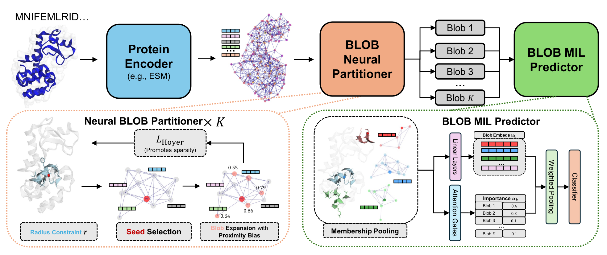
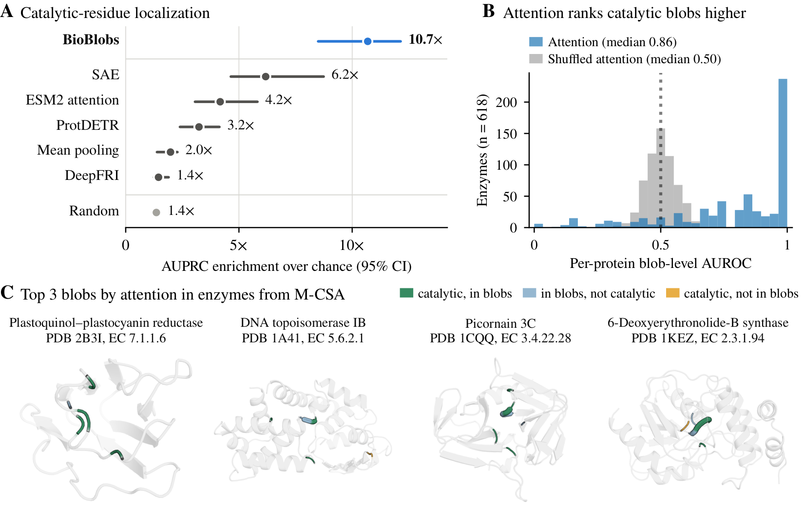

# BioBlobs

Code for **Unsupervised discovery of Functional Substructures** by Xin Wang, Kaiwen Shi and
Carlos Oliver (NeurIPS 2026). [Paper](https://arxiv.org/abs/2510.01632) ·
[Interactive viewer](https://oliverlaboratory.com/resources/bioblobs/) ·
[Model](https://huggingface.co/xwang112358/BioBlobs) ·
[Data](https://huggingface.co/datasets/xwang112358/BioBlobs-data)

BioBlobs predicts protein function from a small set of learned, spatially local substructures
called blobs. It works on frozen residue embeddings from a protein language model (ESM2 or SaProt)
and the protein's structure. The blobs that carry a prediction point to candidate functional
sites, although the model never sees residue-level labels.

> 🔬 **[Explore the blobs in your browser](https://oliverlaboratory.com/resources/bioblobs/#1k32-A)**: the interactive viewer shows
> BioBlobs blobs on M-CSA enzymes next to their annotated catalytic residues, with nothing to
> install.

This `baselines` branch adds the paper's comparison methods and baselines. The `main` branch holds
BioBlobs only.



## Install

Linux x86_64 with Python 3.12, PyTorch 2.7 (CUDA 12.8) and PyTorch Geometric. `uv` installs the
pinned environment from `uv.lock`:

```bash
git clone https://github.com/OliverLaboratory/BioBlobs.git
cd BioBlobs
uv sync
source .venv/bin/activate
```

ESM2 and SaProt weights download from Hugging Face on first use. SaProt also needs
[Foldseek](https://github.com/steineggerlab/foldseek) to compute structure tokens.

## Predict EC numbers and catalytic sites for your enzymes

The released model predicts an enzyme's Enzyme Commission (EC) number to the third level (242
classes) and infers its catalytic site from the blobs, without residue-level labels. It is the
model behind the paper's M-CSA results. Download it from
[Hugging Face](https://huggingface.co/xwang112358/BioBlobs) and run it on your enzyme structures:

```bash
hf download xwang112358/BioBlobs --local-dir bioblobs-mcsa-rvq-k8
python inference.py --model bioblobs-mcsa-rvq-k8 --pdb-dir my_pdbs --out results
```

This writes `results/predictions.csv` with the top EC class of each enzyme, and one JSON file per
enzyme with the top classes, the blobs ranked by importance score with their residue numbers, and
per-residue scores. The paper scores catalytic residues with `max_membership`.
[docs/PREDICT.md](docs/PREDICT.md) describes the options and outputs.

The [interactive viewer](https://oliverlaboratory.com/resources/bioblobs/#1k32-A) shows the model's blobs on M-CSA enzymes next to their annotated
catalytic residues.

[](https://oliverlaboratory.com/resources/bioblobs/#1k32-A)

*Figure 2 of the paper. A: catalytic-residue localization on 74 held-out M-CSA enzymes. B: MIL
attention ranks blobs that contain catalytic residues above the other blobs. C: the three
highest-attention blobs in four enzymes.*

## Train and evaluate

Each reported setting has an experiment config in `conf/experiment/`. After preparing a dataset
once, train three seeds and evaluate one of them:

```bash
python train_bioblobs.py -m +experiment=venusx/act_esm2_labelfree training.seed=1,2,3
python evaluate.py --checkpoint outputs/venusx/act_esm2_labelfree/seed1/best.ckpt \
    --score weighted_membership --out results/act_esm2_labelfree_seed1
```

The ProteinShake and VenusX structures, labels and splits, and the VenusX embeddings behind the
paper, are in the dataset repository
[xwang112358/BioBlobs-data](https://huggingface.co/datasets/xwang112358/BioBlobs-data).
[docs/REPRODUCE.md](docs/REPRODUCE.md) gives the data preparation steps and the command behind each
table and figure.

## Repository layout

```
train_bioblobs.py       train, select on validation, test once
evaluate.py             test metrics and residue localization (ProteinShake, VenusX, M-CSA)
inference.py            predictions, blobs and residue scores for your PDB files
bioblobs/
  model.py              BioBlobs: encoder -> partitioner -> (RVQ) -> MIL predictor
  objectives.py         Hoyer sparsity, seed alignment, class-balanced weights
  modules/              encoder, partitioner, MIL predictor, RVQ, and the comparator models
  data/                 structures, embedding caches, ProteinShake, VenusX, Swiss-Prot EC, M-CSA
  training/             Lightning module, trainer, metrics
  localization/         residue scores, AUROC / AUPRC / F1@L, score baselines
conf/                   Hydra configs, with the paper's settings in conf/experiment/
preprocessing/          dataset download, structure parsing and embedding caches
baselines/mcsa/         M-CSA localization baselines and the table script
data/mcsa/              M-CSA chain annotations and the evaluated enzyme lists
tests/                  CPU smoke tests
```

## Data

- [ProteinShake](https://github.com/BorgwardtLab/proteinshake) tasks: GO-MF, EC, Pfam, SCOP-FAM and SCOP-SF.
- [VenusX](https://github.com/ai4protein/VenusX) functional-site datasets, with site annotations from InterPro.
- Swiss-Prot enzymes from the [EC-Bench](https://github.com/dsaeedeh/EC-Bench) training set, with
  AlphaFold DB v6 structures, for the EC model behind the M-CSA results.
- Catalytic residues from the [Mechanism and Catalytic Site Atlas](https://www.ebi.ac.uk/thornton-srv/m-csa/)
  (CC BY 4.0). `data/mcsa/` ships the chains and enzyme lists used in the paper.

Each source keeps its own terms of use.

## Citation

```bibtex
@inproceedings{wang2026bioblobs,
  title     = {Unsupervised discovery of Functional Substructures},
  author    = {Wang, Xin and Shi, Kaiwen and Oliver, Carlos},
  booktitle = {Advances in Neural Information Processing Systems},
  year      = {2026}
}
```

## License

MIT, see [LICENSE](LICENSE). The third-party models wrapped in `baselines/mcsa/` keep their own
licenses.
